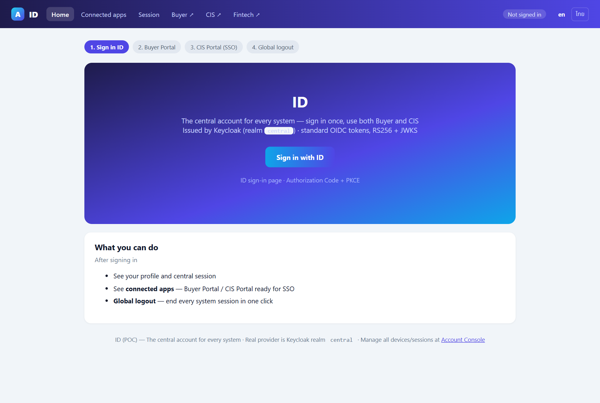
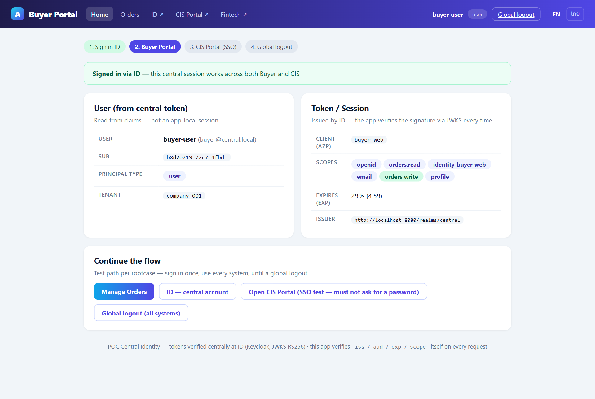
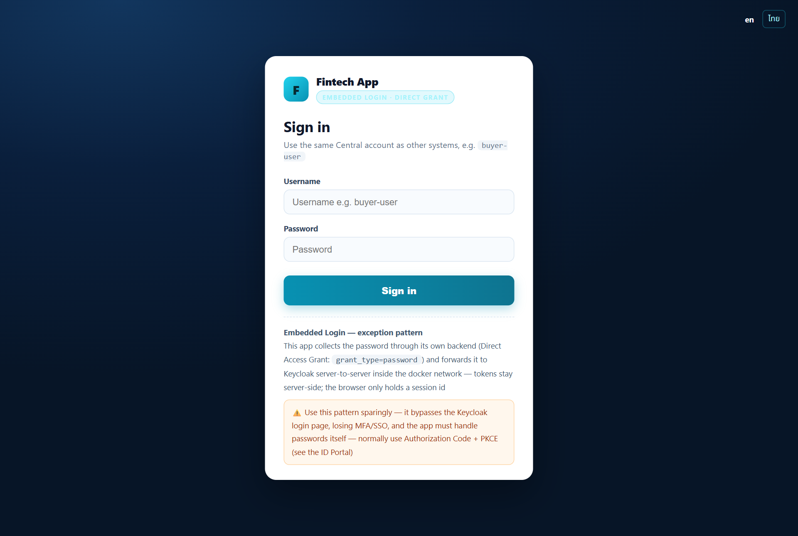
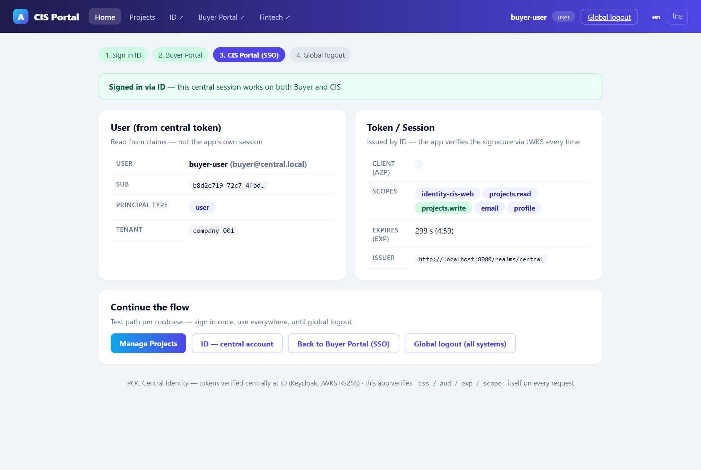
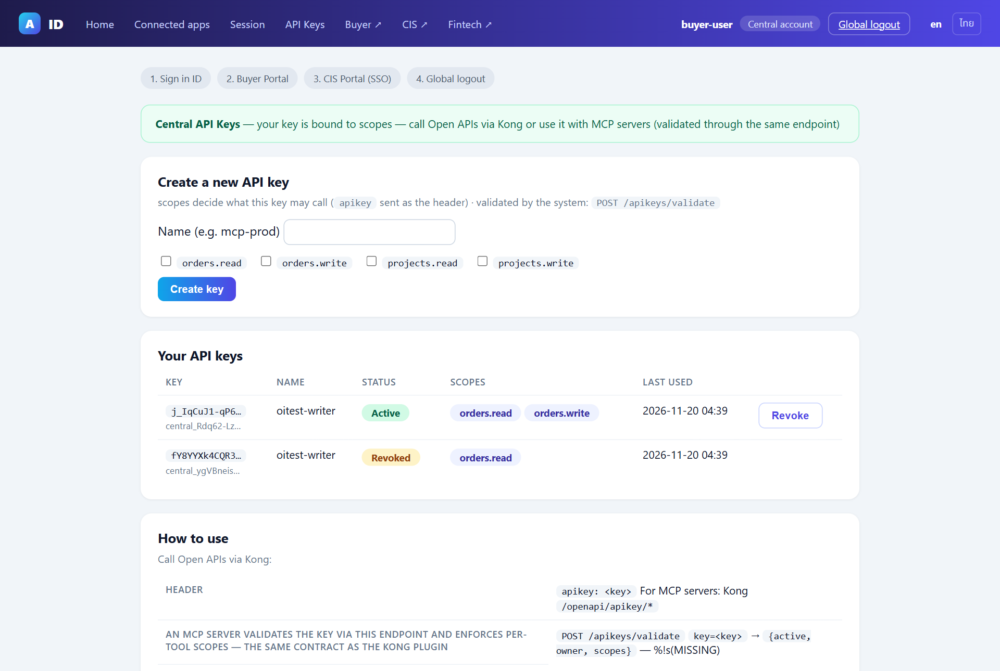
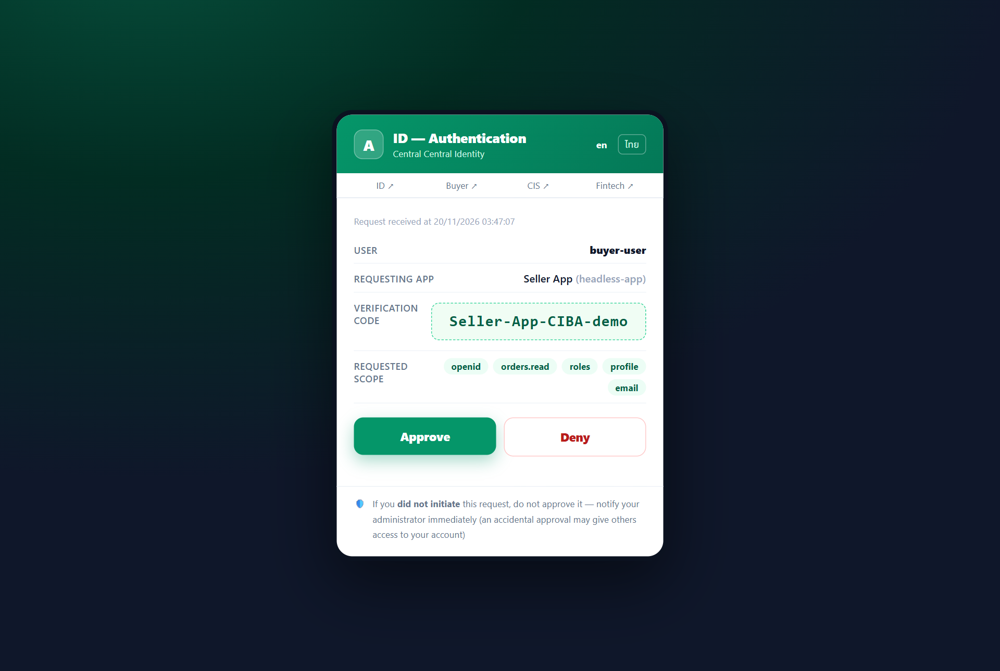

# POC: Central Identity — Central ID + Keycloak + Kong Gateway

Proof of Concept สำหรับยกระดับ Central ID ให้เป็น **Central Identity Provider** ที่ควบคุม Token, Session และสิทธิ์ของทุกระบบ (Buyer, CIS, Open API) จากจุดเดียว โดยใช้ **Keycloak (Free/Open Source)** เป็น Authorization Server และ **Kong Gateway (OSS)** เป็น API Gateway

> เอกสารอ้างอิงปัญหาเดิม: [rootcase.md](rootcase.md) · 📐 **ภาพรวมสถาปัตยกรรม (Mermaid)**: [docs/ARCHITECTURE.md](docs/ARCHITECTURE.md) · 🔎 **วิเคราะห์ SPoF/HA**: [docs/SPoF-ANALYSIS.md](docs/SPoF-ANALYSIS.md) · 🇬🇧 English version (default): [README.md](README.md) · 🌐 UI สลับภาษา EN/ไทย ได้ที่หัวทุกหน้า (หรือ ?lang=en)

---

## 1. ปัญหาที่ต้องแก้ (จาก rootcase.md)

สถานะปัจจุบัน:

```
                 Central ID — session กลาง
                      │
             Login / ยืนยันตัวตน
                      │
          ┌───────────┴───────────┐
        Buyer                    CIS
  access/refresh token     access/refresh token
      ของ Buyer                 ของ CIS
```

- มี SSO อยู่แล้ว: login Buyer → redirect มาที่ Central ID → เปิด CIS แล้ว auto login ได้
- **แต่** แต่ละระบบนำ token ตอน redirect ไป **gen token ใหม่บนระบบของตัวเอง** access/refresh token เกิดแยกกัน
- เมื่อ session ของ Central ID หมดอายุ → ต้อง login ใหม่ แต่ระบบอื่น **ยังทำงานต่อได้** จาก token ของตัวเอง → session ไม่สัมพันธ์กัน
- ต้องการทำ **Open API + API key** ให้ Partner แต่ไม่มีข้อตกลงกลางว่า "ใครออก credential และแต่ละ API ตรวจ credential นั้นอย่างไร"

## 2. เป้าหมายของ POC

| # | โจทย์ | ผลลัพธ์ที่ต้องพิสูจน์ |
| - | ----- | --------------------- |
| 1 | SSO จริงระหว่างระบบ | Login ผ่าน Keycloak ครั้งเดียว → Buyer และ CIS auto login ด้วย session กลางเดียว |
| 2 | Central Token | Buyer/CIS **ตรวจ token กลางผ่าน JWKS** แทนการออก token เอง (มี Dual Validation รองรับ token เดิมช่วง migration) |
| 3 | Session Lifecycle สัมพันธ์กัน | Logout / Disable user ที่ Keycloak → ทุกระบบปฏิเสธ token ตาม Security SLA |
| 4 | Open API สำหรับ Partner | Partner ได้ `client_id`/`client_secret` → Client Credentials Grant → เรียก API ผ่าน Kong → ตรวจ `aud` + `scope` + Tenant |
| 5 | API Key เทียบกับ OAuth | ทดลอง Kong `key-auth` plugin เทียบกับ OAuth Client Credential เพื่อเลือกใช้งานจริง |
| 6 | Gateway Role ของ Kong | Routing, Rate Limiting, API Protection — ไม่ใช่ตัวแทน SSO |

### Out of Scope ของ POC
- Migration ข้อมูล user จริงทั้งหมด (ใช้ user ทดสอบใน Keycloak)
- Identity Brokering กับ Central ID จริง (POC ใช้ user ใน Keycloak ก่อน — แนบแผน Option A/B ไว้ให้)
- Production hardening ทั้งหมด (HA, Monitoring เชิงลึก, WAF)

## 3. สถาปัตยกรรมเป้าหมายของ POC

```
   ผู้ใช้ (Browser)
      │ OIDC Authorization Code + PKCE
      ▼
┌─────────────────────────────┐
│  Keycloak (Central Identity)│  SSO · Access/Refresh Token · JWKS · Revocation
└──────────┬──────────────────┘
           │ JWT (RS256)
   ┌───────┴────────┐              Partner / External System
   ▼                ▼                      │ client_credentials
 Buyer App       CIS App                   ▼
 (NestJS)        (Go Fiber)        ┌──────────────────┐
 AuthGuard       Auth Middleware   │  Kong Gateway OSS │  Routing · Rate Limit · Key Auth
 (JWKS verify)   (JWKS verify)     └────────┬─────────┘
   │                │                       ▼
 Business        Business            Buyer Open API / CIS Open API
 Authorization   Authorization       (ตรวจ aud + scope + Tenant อีกชั้น)
```

### การแบ่งหน้าที่ (Responsibility)

| Layer | ตรวจอะไร | ผู้รับผิดชอบ |
| ----- | -------- | ------------ |
| Keycloak | ออก Token, Refresh, Revoke, Session, SSO | Central Identity |
| Kong OSS | Routing, Rate Limit, Request Size, Key Auth | API Gateway |
| Authentication (Buyer/CIS) | Signature, `iss`, `aud`, `exp`, `alg` | Guard / Middleware + JWKS |
| API Authorization | `scope` ที่ endpoint ต้องการ | Guard / Middleware |
| Tenant / Resource Authorization | สิทธิ์บริษัท, Order/Project | Business Service ของแต่ละระบบ |

> หลักสำคัญ: **ไม่สร้าง Middleware Service กลาง** ที่ทุก Request ต้อวิ่งไปหา (Latency + Single Point of Failure) — แต่ละ API ตรวจ JWT เองด้วย Public Key จาก JWKS ที่ cache ไว้

## 4. Token Contract (ต้องตกลงร่วมกันก่อน Implement)

JWT Access Token แบบ **RS256** ที่ Keycloak ออกให้:

```json
{
  "iss": "http://localhost:8080/realms/central",
  "sub": "user_123",
  "aud": "buyer-api",
  "client_id": "buyer-web",
  "scope": "orders.read orders.write",
  "principal_type": "user",
  "iat": 1794460000,
  "exp": 1794460900,
  "jti": "token_abc123"
}
```

| Claim | Buyer | CIS | Open API (M2M) | Central ID Portal | Mobile App |
| ----- | ----- | --- | -------------- | ----------------- | ---------- |
| `iss` | Keycloak realm `central` | เดียวกัน | เดียวกัน | เดียวกัน | เดียวกัน |
| `aud` | `buyer-api` | `cis-api` | `buyer-api` / `cis-api` | `central-id` | `buyer-api` |
| `sub` | Central User ID | Central User ID | client id ของ Partner | Central User ID | Central User ID |
| `scope` | `orders.*` | `projects.*` | scope ตามที่ผูกไว้กับ client | `openid profile email` | `orders.read` |
| `principal_type` | `user` | `user` | `service` | `user` | `user` |

> **Fintech App (Embedded Login)** เป็น confidential client (Direct Grant — **exception pattern** สำหรับแอป first-party ที่ต้องการฟอร์มเอง; brute force realm-wide ล็อกข้ามแอปที่ ID กลาง) — brute force นับรวมทุก client: ผิด 5 ครั้งที่แอปใด → buyer-user ถูกล็อก 30s ทุกแอป
> **STT Session Transfer (ข้ามแอปทุกคู่)** — ต้นทาง (mobile/fintech) สร้าง one-time code ที่ ID Portal (`POST /stt/create` + `dest`) แล้วพา browser ไปจุดรับของปลายทาง `/auth/stt?code=` — ทุกปลายทางตรวจ `aud` ของตัวเองก่อนรับ session; เคส **aud ต่างกัน (→ CIS)** ใช้ **Token Exchange (KC Standard V2)** แลกเป็น token `aud=cis-api` โดย token ต้นทางต้องมี scope `stt-bridge` (เติม cis-web ใน aud) — code ใช้ครั้งเดียว อายุ 60 วิ ผูกปลายทาง — จำลอง Native-to-Web SSO แบบ Auth0 — ดู ADR-004 + ทดสอบ `scripts/stt-test.sh` (ผล §1 ข้อ 19)
> **SSO Ticket ของ ID กลาง** — fintech login สำเร็จจะออกตั๋ว `central_sso` ให้ browser (cookie ของ host localhost — browser ส่งให้ทุก port ใน POC) → **เปิด Buyer/CIS แท็บใหม่ตรง ๆ ก็ SSO เข้าเลย** ไม่ต้องกลับมากดปุ่มที่ fintech — ตั๋ว reusable 30 นาที + broker ต่ออายุ token ใหม่ให้อัตโนมัติ (เก็บ refresh_token ไว้) + **Logout กลาง propagate จริง**: session ปลายทางผูกกับตั๋ว → logout ที่แอปใดก็ได้ (revoke ทุกตั๋ว) → แอปอื่นตายตามตั้งแต่ request ถัดไป — ผล §1 ข้อ 20
> **Central API Keys** — ผู้ใช้ออก API key ผูก scope จากหน้า /apikeys ของ ID Portal (:3000) — key (header `apikey` หรือ `X-API-Key` — รองรับทั้งคู่) ใช้กับ Kong route `/openapi/apikey/*` และ MCP server (ตรวจผ่าน POST /apikeys/validate — contract เดียวกับ Kong plugin) — ดู ADR-005
> **Headless App (CIBA)** เป็น confidential client (`oidc.ciba.grant.enabled=true`) — แอปทำหน้า login เอง ไม่ redirect ไป Keycloak เลย (ผู้ใช้ยืนยันผ่านอุปกรณ์ ID :3040) — token มี aud=buyer-api ผ่าน identity-buyer-web ใช้กับ Buyer API เดิมได้ทันที — รายละเอียด: research-headless-auth.md
> **Mobile App** เป็น public client (ไม่มี secret) — บังคับ **PKCE S256** ที่ server, login ผ่าน system browser ตาม RFC 8252 (ไม่ใช้ WebView), refresh token rotation + reuse detection (ขโมย token เก่า → ยกเลิกทั้งตระกูล) — รายละเอียดทดสอบที่ `scripts/mobile-test.sh`

**กฎเหล็ก:** ห้าม CIS ยอมรับ token ที่ `aud` เป็น `buyer-api` เพียงเพราะ signature ถูก — ตรวจ `aud` เสมอ และห้ามตัดสิน user/service จากการมีหรือไม่มี `sub` เพียงอย่างเดียว ให้ใช้ `principal_type`

### Keycloak Endpoints ที่ใช้ใน POC

| Endpoint | URL |
| -------- | --- |
| Issuer | `http://localhost:8080/realms/central` |
| Authorization | `/realms/central/protocol/openid-connect/auth` |
| Token | `/realms/central/protocol/openid-connect/token` |
| JWKS | `/realms/central/protocol/openid-connect/certs` |
| Introspection | `/realms/central/protocol/openid-connect/token/introspect` |
| Revocation | `/realms/central/protocol/openid-connect/revoke` |
| Logout | `/realms/central/protocol/openid-connect/logout` |

## 5. โครงสร้างโปรเจกต์

```
poc-kong-keycloak/
├── README.md                        ← ไฟล์นี้
├── README.md                        ← English README (ค่าเริ่มต้นสำหรับ public)
├── README-TH.md                     ← ไฟล์นี้ (Thai)
├── CLAUDE.md                        ← Rule สำหรับการพัฒนาใน repo นี้
├── rootcase.md                      ← บันทึกปัญหาเดิม (ต้นทางของ POC)
├── docker-compose.yml               ← Keycloak + Kong (DB-less) + Postgres + Services
├── .env.example                     ← ตัวอย่างค่า config (copy เป็น .env ก่อนรัน)
├── keycloak/
│   ├── central-realm.template.json  ← Template ของ realm (clients, scopes, users, mappers)
│   └── central-realm.json           ← Generated โดย setup.sh (gitignore)
├── kong/
│   ├── kong.template.yml            ← Template declarative config (services, routes, plugins)
│   ├── kong.yml                     ← Generated โดย setup.sh (ฝัง realm public key + secrets + explicit ids)
│   └── custom/                      ← Custom Kong plugins (Lua): oidc-central · oidc-introspect · central-apikey
├── services/
│   ├── buyer-api/                   ← Mock Buyer (NestJS): Central Guard + Legacy + Dual + OIDC/PKCE
│   └── cis-api/                     ← Mock CIS (Go Fiber): Central Middleware + Legacy + Dual
├── scripts/
│   ├── _lib.sh                      ← Helper ร่วมของ scripts (token, check, summary)
│   ├── setup.sh                     ← (ครั้งแรก) import realm → ดึง public key → สร้าง kong.yml → ขึ้น stack
│   ├── 00-check-env.sh              ← ตรวจว่าเครื่องพร้อมรัน
│   ├── 10-keycloak-smoke.sh         ← Phase 1: ออก token + ตรวจ claims
│   ├── 20-services-smoke.sh         ← Phase 3-4: 401/403 พื้นฐานของ Buyer/CIS
│   ├── sso-test.sh                  ← Phase 5: SSO flow + logout แบบ script
│   ├── openapi-test.sh              ← Phase 6-7 + Kong extensions: jwt/key-auth/rate-limit/cors/size + custom oidc plugins + portal routes
│   ├── revocation-test.sh           ← Phase 8: introspect/revoke/disable
│   └── dual-validation-test.sh      ← Phase 9: legacy + central + token นอก allowlist
└── docs/
    ├── test-results.md              ← บันทึกผลทดสอบแต่ละ Scenario
    ├── migration-plan.md            ← แผน Migration Option A/B สู่ Production
    ├── research-headless-auth.md    ← Research ความเป็นไปได้ Headless Auth (CIBA vs Custom Extension)
    ├── (services: central-id :3000 · headless-demo :3030 · id-device :3040 · fintech-web :3050 — Embedded Login exception demo)
    └── ADR-001/002/003/004          ← การตัดสินใจสถาปัตยกรรม (IdP / Token Contract / Kong / STT+Token Exchange)
```

## 6. ขั้นตอนการทำ POC (Phases)

| Phase | งาน | ผลลัพธ์ | สถานะ |
| ----- | --- | ------- | ----- |
| 1 | Deploy Keycloak (Dev) — realm `central`, clients, test users | ออก token ผ่าน Client Credentials / Authorization Code ได้ | ✅ |
| 2 | Deploy Kong OSS — routes + rate limiting หน้า mock API | Request ผ่าน Kong ถึง Buyer/CIS ได้ | ✅ |
| 3 | Buyer (NestJS) Central AuthGuard — JWKS + `aud=buyer-api` | รับ central token ได้, ปฏิเสธ token ผิด `aud` | ✅ |
| 4 | CIS (Go Fiber) Central Auth Middleware — JWKS + `aud=cis-api` | เหมือน Phase 3 แต่ฝั่ง Go | ✅ |
| 5 | SSO Flow — Authorization Code + PKCE จาก Buyer ไป CIS | Login ครั้งเดียว auto login ทั้งสองระบบ | ✅ |
| 6 | Open API — Client Credentials ผ่าน Kong + Scope enforcement | Partner เรียก Open API สำเร็จ / โดนปฏิเสธเมื่อ scope ไม่พอ | ✅ |
| 7 | API Key เทียบ OAuth — Kong `key-auth` vs client credential | สรุปข้อดีข้อเสียจากการทดลองจริง | ✅ |
| 8 | Revocation & Logout — revoke token, disable user, logout กลาง | ทุกระบบปฏิเสธ token ตาม SLA (ไม่เกิน token lifetime) | ✅ |
| 9 | Dual Validation — legacy token + central token พร้อมกัน | Code เดิมยังทำงานได้ระหว่าง migration | ✅ |
| 10 | สรุปผล + แผน Migration Option A/B | เอกสารเสนอทีม | ✅ |
| 11 | Extension: Headless CIBA (Phase 0 pilot จาก research) + Fintech Embedded Login + Brute Force + STT ข้ามแอป + SSO Ticket (เปิดแท็บใหม่ไม่ login) | `ciba-test.sh` 16/16 · `fintech-test.sh` 5/5 · `stt-test.sh` 33/33 | ✅ |
| 12 | Central API Keys (ออก key ผูก scope จาก ID Portal) + custom Kong plugins (gateway OIDC/introspection) + MCP Server + portal routing + i18n EN/ไทย | `openapi-test.sh` 31/31 · `mcp-test.sh` 12/12 | ✅ |
| 12 | Central API Keys (ออก key ผูก scope จาก ID Portal) + custom Kong plugins (gateway OIDC/introspection) + MCP Server + portal routing + i18n EN/ไทย | `openapi-test.sh` 31/31 · `mcp-test.sh` 12/12 | ✅ |

> **สถานะ (2026-11-20, ระบบใช้ชื่อกลาง "central" — template-ready):** ทดสอบครบทุก Phase แล้ว — **14 scripts, 198/198 checks PASS** (sweep ครบ: smoke/SSO/openapi/revocation/dual-validation/mobile/CIBA/STT v2/Fintech — รายละเอียด + สิ่งที่พบที่ [docs/test-results.md](docs/test-results.md)) เหลือเฉพาะ browser demo ด้วยมือ (checklist ใน test-results §3) และเคส Tenant reject เมื่อ tenant ไม่ใช่ hardcoded (⚠️ ดู §1 ข้อ 7)

## 7. วิธีรัน (เมื่อ Scaffold แล้ว)

```bash
# 0) ตั้งค่าครั้งแรก
cp .env.example .env          # แก้รหัสผ่าน/secret ตามต้องการ
bash scripts/setup.sh         # import realm → ดึง public key → สร้าง kong.yml → ขึ้น stack ทั้งหมด
bash scripts/00-check-env.sh  # ตรวจว่าเครื่องพร้อม

# ถ้ารัน setup.sh ก่อนหน้านี้แล้ว (มี realm.json + kong.yml อยู่) ใช้แบบสั้นได้:
# docker compose up -d --build

# 2) ทดสอบตาม Phase (รันตามลำดับ)
bash scripts/10-keycloak-smoke.sh       # Phase 1  Keycloak ออก token
bash scripts/20-services-smoke.sh       # Phase 3-4  Buyer/CIS ตรวจ central token
bash scripts/sso-test.sh                # Phase 5  SSO + logout (ผ่าน Identity Brokering)
bash scripts/openapi-test.sh            # Phase 6-7 Kong (jwt/key-auth/rate-limit/cors/size + custom oidc plugins + portal routes + central api keys)
bash scripts/revocation-test.sh         # Phase 8  revoke/disable
bash scripts/dual-validation-test.sh    # Phase 9  legacy + central
bash scripts/mobile-test.sh             # Mobile (public client + PKCE + rotation + anti-theft)
bash scripts/setup-ciba.sh              # Phase 0: ตั้งค่า CIBA policy + client headless-app (idempotent)
bash scripts/ciba-test.sh               # Phase 0: Headless login E2E (CIBA request→approve→token→Buyer 200)
bash scripts/setup-fintech.sh           # Fintech: brute force policy + client fintech-web (idempotent)
bash scripts/fintech-test.sh            # Fintech: login form เอง (Direct Grant exception) + brute force lockout E2E
bash scripts/setup-stt.sh               # STT v2: scope stt-bridge + cis-web confidential + เปิด Token Exchange (idempotent)
bash scripts/stt-test.sh                # STT v2: โอน session ข้ามแอป Buyer/CIS/Fintech + dest binding + Token Exchange
bash scripts/mcp-test.sh                # MCP server (Streamable HTTP): apikey auth + scope-gated tools

# Central API Keys — ออก key ผูก scope จาก ID Portal แล้วเรียก Open API
UT=$(curl -s "http://localhost:8080/realms/central/protocol/openid-connect/token" -d grant_type=password -d client_id=buyer-web -d username=buyer-user -d password="$TEST_USER_PASSWORD" -d scope=openid | sed -n 's/.*"access_token":"([^"]*)".*//p')
curl -s -X POST http://localhost:3000/apikeys/create -H "Authorization: Bearer $UT" -d name=demo -d scopes=orders.read
curl -H "apikey: <key>" http://localhost:8000/openapi/apikey/orders   # 200
bash scripts/mcp-test.sh                # MCP server (Streamable HTTP): apikey auth + scope-gated tools

# Identity Brokering — จำลอง "Central ID จริง" เป็น IdP ต้นทาง (Option B ใน migration-plan)
# ผู้ใช้ login ที่ upstream realm (ธีมเขียว) → realm central (ซ่อนเบื้องหลัง) ออก token ให้แอป
# รันครั้งแรกหรือเมื่ออยาก reset: idempotent (ลบของเดิมสร้างใหม่เสมอ)
bash scripts/setup-brokering.sh

# เช็คสถานะ container
docker compose ps

# Keycloak Admin Console — http://localhost:8080 (admin / ค่าใน .env — ห้าม commit)
# Kong Admin API — curl http://localhost:8001/services

# 3) Demo ด้วยหน้าจอ (จำลอง flow rootcase — 3 แอปจริง)
#    Central ID Portal :3000 (บัญชีกลาง: โปรไฟล์/แอปที่เชื่อมต่อ/session/logout กลาง)
#    Buyer Portal      :3010 (NestJS — Orders)
#    CIS Portal        :3020 (Go Fiber — Projects)
#    เดิน flow: เปิด :3000 → ล็อกอิน (หน้า login ธีม Central ID) → เปิดแอป Buyer/CIS จากหน้า "แอปที่เชื่อมต่อ"
#    → SSO อัตโนมัติไม่ถามรหัสผ่าน → กด "Logout กลาง" ที่แอปใดก็ได้ → ทุกแอปต้อง login ใหม่
#    แถบขั้นตอน flow แสดงบนทุกหน้า + จัดการอุปกรณ์/session ทั้งหมดที่ Account Console (:8080/realms/central/account)

# 4) บันทึกผลทุกครั้งที่ docs/test-results.md และอัปเดตสถานะ Phase ด้านบน
```

## 8. Test Scenarios (Acceptance Criteria ของ POC)

| Test | Expected |
| ---- | -------- |
| ไม่มี Authorization Header | 401 |
| Token หมดอายุ | 401 |
| Signature ไม่ถูกต้อง | 401 |
| Issuer ไม่ตรง | 401 |
| Buyer Token (`aud=buyer-api`) เรียก CIS API | 401 |
| Scope ไม่เพียงพอ | 403 |
| ไม่มีสิทธิ์ Tenant | 403 หรือ 404 |
| JWKS Key Rotation | ตรวจ Token ด้วย Key ใหม่ได้ (ไม่ต้อง deploy ใหม่) |
| Refresh Token ถูก Revoke | ขอ Token ใหม่ไม่ได้ |
| User ถูก Disable ที่ Keycloak | ทุกระบบระงับตาม Security SLA |
| Partner Client ถูก Revoke | ขอ Token ใหม่ไม่ได้ |
| Legacy Token หลัง Cutover | 401 |
| Login Buyer → เปิด CIS | Auto login (SSO session เดียว) |
| Logout ที่ Keycloak | Session ทุกระบบถูกยุติ |
| MCP tools/list ด้วย key read-only | ไม่เห็น `create_order` (กรองตาม scope) |
| MCP tools/call `create_order` ด้วย key read-only | Tool error ระบุ `orders.write` |
| API key ถูก revoke ที่ ID Portal | Kong gateway ปฏิเสธหลัง cache หมด |
| เปิด Portal ผ่าน Kong (`/portal/…`) | Served ผ่าน gateway · SSO cookie (host-wide) ยังใช้ได้ |

ผลทดสอบทุกข้อบันทึกที่ [docs/test-results.md](docs/test-results.md)

## 9. แผนสู่ Production (สรุปจาก rootcase.md)

### ทางเลือกเชื่อม Central ID กับ Keycloak
- **Option A — Keycloak เป็น IdP หลัก**: ย้าย Authentication ไป Keycloak, Central ID เหลือหน้าที่ User Profile / Business Identity → Migration Impact สูง
- **Option B — Keycloak เป็น Identity Broker**: Keycloak เชื่อม Central ID ผ่าน OIDC/SAML, Central ID ยังเป็นระบบ Login เดิม → รักษา Login Experience เดิม, ต้องออกแบบ Sync Logout/Disable

POC นี้เริ่มจาก user ใน Keycloak ก่อน แล้วประเมิน Option B เป็นลำดับแรกหาก Central ID รองรับ OIDC มาตรฐาน

### Migration ระดับ Middleware (Dual Validation)

| Phase | Middleware Behavior |
| ----- | ------------------- |
| 1 | เพิ่ม Central Token Validator แต่ยังไม่เปิดใช้ |
| 2 | รองรับ Legacy + Central Token |
| 3 | Buyer Login เริ่มรับ Central Token |
| 4 | CIS Login เริ่มรับ Central Token |
| 5 | Open API รับเฉพาะ Central Token |
| 6 | ปิด Legacy Token Validator |

> ข้อควรระวัง: Dual Validation ต้องเลือก Validator จาก **Allowlist ที่กำหนดล่วงหน้า** เท่านั้น — ห้ามเชื่อ `iss`/`kid`/`alg` จาก token ก่อน verify เพื่อป้องกัน Cross-Issuer / Cross-Audience Token Confusion

## 10. สรุปข้อเสนอ (จาก rootcase.md)

- Keycloak แก้ปัญหาหลัก: **Token Issuance, SSO, Session Lifecycle, Revocation**
- Kong แก้ปัญหา: **API Management** หน้า Open API (Routing, Rate Limit, Key Auth) — ไม่ใช่ตัวแก้ SSO
- Kong OSS **ไม่มี OIDC Plugin** (เป็น Enterprise Only) → POC นี้เขียน custom plugin (oidc-central) ตรวจ JWKS + aud + scope ที่ gateway เพิ่ม; การตรวจลึกยังอยู่ที่ Guard/Middleware ของ Buyer/CIS
- สร้าง Shared Contract ให้ชัดก่อนเขียนโค้ด: Claims, JWKS, Expiration/Refresh Policy, Principal Mapping, Logout/Revocation SLA, Legacy Migration

## 11. Central API Keys + MCP Server

**Central API Keys** — ผู้ใช้ออก API key ผูก scope จากหน้า `/apikeys` ของ ID Portal (:3000): เลือก scope (orders.*/projects.*) ได้ตามต้องการ · key แสดงเต็มครั้งเดียว · ยกเลิกได้ทันที (ไม่ต้องแตะ kong.yml)

การใช้งาน (สองทาง — contract เดียวกัน):
1. **Open API ผ่าน Kong**: route `/openapi/apikey/*` ใช้ custom plugin `central-apikey` — ตรวจ key กับ `POST /apikeys/validate` (cache 15s) → บังคับ scope ตาม method (GET→orders.read / POST→orders.write) → ส่งต่อด้วย gateway-trust header
2. **MCP Server**: Buyer เปิด **remote MCP server (Streamable HTTP)** ที่ `:3010/mcp` — ตรวจ key ด้วย validate endpoint เดียวกัน และบังคับ scope ต่อ tool:
   - `whoami` — ไม่ต้องใช้ scope
   - `list_orders` — ต้องมี orders.read
   - `create_order` — ต้องมี orders.write (key ที่ไม่มี → isError พร้อมเหตุผล)

เชื่อมต่อจาก MCP client (Claude Code, Cursor ฯลฯ):
```json
{ "mcpServers": { "central-buyer": { "url": "http://localhost:3010/mcp",
  "headers": { "apikey": "central_<key จาก ID Portal>" } } } }
```

ทดสอบ: `bash scripts/mcp-test.sh` (12 checks) · รายละเอียด: ADR-005 · finding 54/55

## 12. Screenshots

ภาพหน้าจอทั้ง 30 ภาพ (โหมด English) อยู่ที่ [docs/screenshots/](docs/screenshots/) — regenerate ได้ด้วย `tools/screenshots/*.mjs`:

| | |
| --- | --- |
|  |  |
|  |  |
|  |  |

## 13. Troubleshooting (สิ่งที่เจอจริงระหว่างทำ)

| อาการ | สาเหตุ | วิธีแก้ |
| ----- | ------ | ------ |
| port 3000 ถูกใช้ (Windows) | node process ค้าง | `netstat -ano \| findstr :3000` → `taskkill /F /PID <pid>` |
| request ผ่าน Kong ช้า 4-8 วิ | Kong default DNS order ลอง SRV ก่อนแล้วโดน SERVFAIL บน Docker Desktop | ตั้ง `KONG_DNS_ORDER: "A"` ใน compose (ตั้งไว้แล้ว) |
| Kong start ไม่ขึ้น: `table index is nil` (declarative) | บั๊ก Kong 3.9 กับ config หลาย entity ซ้อน | `setup.sh` ฉีด explicit `id` ทุก entity แล้ว — rerun `bash scripts/setup.sh` |
| `buyer-user` 401 ระหว่างรัน test ซ้ำ ๆ | brute-force protection ล็อกบัญชี (ตามดีไซน์) | ปลดผ่าน Admin API: `DELETE /admin/realms/central/attack-detection/brute-force/users/buyer-user` |
| MCP client ได้ 401 | ไม่มี/ผิด API key header | ส่ง `apikey: central_…` (ออกที่ ID Portal → API Keys) |
| MCP transport ปฏิเสธ request | client ต้องรับทั้งสอง content type | ส่ง `Accept: application/json, text/event-stream` |

## 14. License

เผยแพร่ภายใต้ [MIT License](LICENSE) — ใช้งาน/แก้ไข/นำไปต่อยอดได้ฟรี
