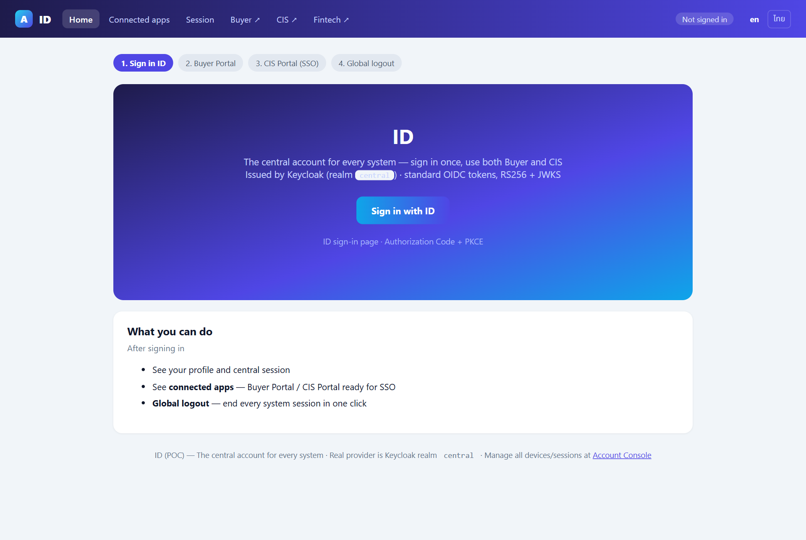
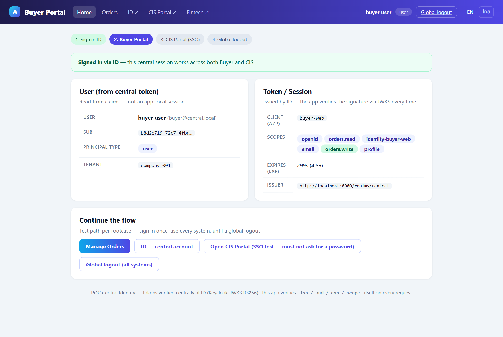
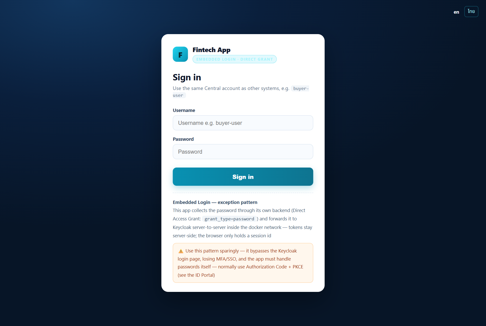
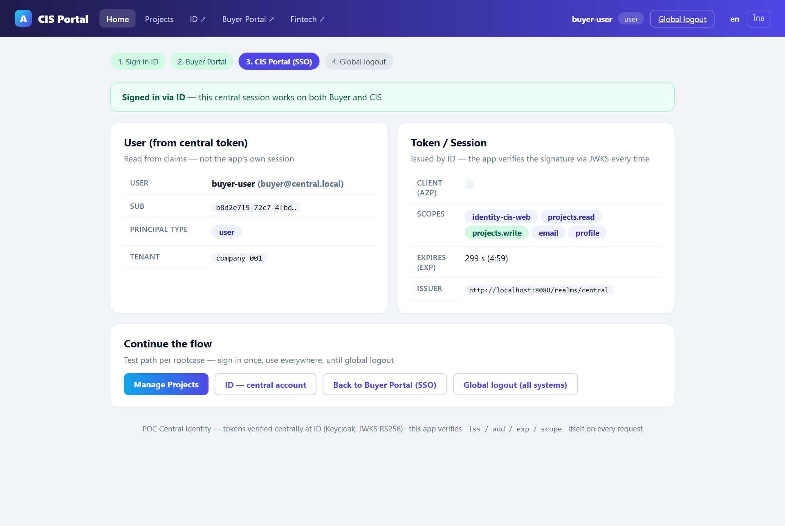
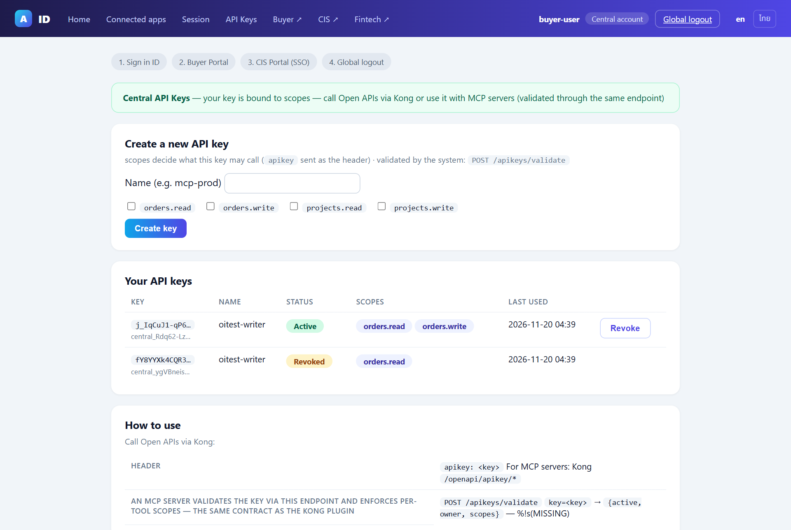
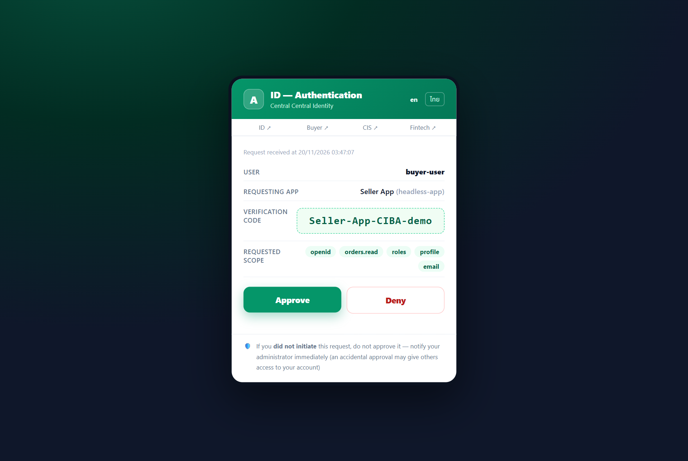

# POC: Central Identity — Central ID + Keycloak + Kong Gateway

A Proof of Concept for turning a Central ID into a full **Central Identity Provider** that controls tokens, sessions and permissions for every system (Buyer, CIS, Open API) from a single place — using **Keycloak (free/open source)** as the Authorization Server and **Kong Gateway (OSS)** as the API Gateway.

> UI language: every app supports **English / Thai** switching (button in the page header, or `?lang=en|th`; persisted in a cookie). The Keycloak login pages are bilingual too. Documentation: this file (English, default) and [README-TH.md](README-TH.md) (Thai).
>
> Original problem statement (Thai): [rootcase.md](rootcase.md) · 📐 **Full architecture diagrams (Mermaid)**: [docs/ARCHITECTURE.md](docs/ARCHITECTURE.md) · 🔎 **SPoF / HA analysis**: [docs/SPoF-ANALYSIS.md](docs/SPoF-ANALYSIS.md) · 🛡️ **Security audit (source-level, 4 questions)**: [docs/SECURITY-AUDIT.md](docs/SECURITY-AUDIT.md)

---

## 1. The problem (from rootcase.md)

Current state:

```
                 Central ID — central session
                      │
             Login / authentication
                      │
          ┌───────────┴───────────┐
        Buyer                    CIS
  access/refresh token     access/refresh token
      of Buyer                 of CIS
```

- SSO already exists: sign in at Buyer → redirect to Central ID → opening CIS auto-logs-in
- **But** each system takes the redirect token and **mints its own tokens** — access/refresh tokens are separate per system
- When the Central ID session expires → user must sign in again, while other systems **keep working** on their own tokens → sessions are inconsistent
- The business wants an **Open API + API key** for partners, but there is no shared agreement on "who issues credentials and how each API validates them"

## 2. POC goals

| # | Goal | What must be proven |
| - | ---- | ------------------- |
| 1 | Real SSO across systems | One Keycloak sign-in → Buyer and CIS auto-login with one central session |
| 2 | Central Token | Buyer/CIS **validate a central token via JWKS** instead of minting their own (Dual Validation supports legacy tokens during migration) |
| 3 | Consistent session lifecycle | Logout / user disable at Keycloak → every system rejects tokens per the security SLA |
| 4 | Open API for partners | Partner gets `client_id`/`client_secret` → Client Credentials Grant → call APIs via Kong → validate `aud` + `scope` + tenant |
| 5 | API Key vs OAuth | Try Kong `key-auth` plugin against OAuth client credentials to decide what to use |
| 6 | Kong's gateway role | Routing, rate limiting, API protection — not an SSO proxy |

### Out of scope for this POC
- Migrating the real user base (test users live in Keycloak)
- Identity brokering with the real Central ID (the POC uses Keycloak users first — Option A/B plan attached)
- Full production hardening (HA, deep monitoring, WAF)

## 3. Target architecture

```
   User (Browser)
      │ OIDC Authorization Code + PKCE
      ▼
┌─────────────────────────────┐
│  Keycloak (Central Identity)│  SSO · Access/Refresh Token · JWKS · Revocation
└──────────┬──────────────────┘
           │ JWT (RS256)
   ┌───────┴────────┐              Partner / External System
   ▼                ▼                      │ client_credentials
 Buyer App       CIS App                   ▼
 (NestJS)        (Go Fiber)        ┌──────────────────┐
 AuthGuard       Auth Middleware   │  Kong Gateway OSS │  Routing · Rate Limit · Key Auth
 (JWKS verify)   (JWKS verify)     └────────┬─────────┘
   │                │                       ▼
 Business        Business            Buyer Open API / CIS Open API
 Authorization   Authorization       (validates aud + scope + tenant again)
```

### Responsibilities

| Layer | What it validates | Owner |
| ----- | ----------------- | ----- |
| Keycloak | Token issuance, refresh, revoke, session, SSO | Central Identity |
| Kong OSS | Routing, rate limit, key auth + custom OIDC plugin (JWKS + aud/scope at the gateway) | API Gateway |
| Authentication (Buyer/CIS) | Signature, `iss`, `aud`, `exp`, `alg` | Guard / Middleware + JWKS |
| API Authorization | Required `scope` per endpoint | Guard / Middleware |
| Tenant / Resource Authorization | Company, order/project permissions | Each system's business service |

> Key principle: **no central middleware service** that every request must pass through (latency + single point of failure) — each API validates the JWT itself using the cached public keys from JWKS.

## 4. Token contract (agree before implementing)

RS256 access tokens issued by Keycloak:

```json
{
  "iss": "http://localhost:8080/realms/central",
  "sub": "user_123",
  "aud": "buyer-api",
  "client_id": "buyer-web",
  "scope": "orders.read orders.write",
  "principal_type": "user",
  "iat": 1794460000,
  "exp": 1794460900,
  "jti": "token_abc123"
}
```

| Claim | Buyer | CIS | Open API (M2M) | Central ID Portal | Mobile App |
| ----- | ----- | --- | -------------- | ----------------- | ---------- |
| `iss` | Keycloak realm `central` | same | same | same | same |
| `aud` | `buyer-api` | `cis-api` | `buyer-api` / `cis-api` | `central-id` | `buyer-api` |
| `sub` | Central User ID | Central User ID | partner client id | Central User ID | Central User ID |
| `scope` | `orders.*` | `projects.*` | scope bound to the client | `openid profile email` | `orders.read` |
| `principal_type` | `user` | `user` | `service` | `user` | `user` |

> **Fintech App (Embedded Login)** — confidential client (Direct Grant — an intentional **exception pattern** for first-party apps that need their own login form; realm-wide brute force protection locks across apps at the ID layer): 5 wrong attempts on any app → 30s lockout for buyer-user everywhere.
> **STT Session Transfer (cross-app)** — the source app (mobile/fintech) creates a one-time code at the ID Portal (`POST /stt/create` + `dest`) and sends the browser to the destination's `/auth/stt?code=`. Every destination validates its own `aud` first; when audiences differ (→ CIS) it uses **Token Exchange (KC Standard V2)** to mint an `aud=cis-api` token — the source token must carry the `stt-bridge` scope (adds cis-web to aud). Codes are one-time, 60s, bound to a destination — an Auth0-style Native-to-Web SSO simulation. See ADR-004 and `scripts/stt-test.sh` (results §1 item 19).
> **Central SSO Ticket** — a successful fintech sign-in issues a `central_sso` ticket cookie to the browser (host-scoped cookie on localhost — the browser sends it to every port in this POC) → **opening Buyer/CIS in a new tab signs in automatically**. Tickets are reusable for 30 minutes; the broker renews tokens automatically (stores the refresh token). **Global logout truly propagates**: destination sessions are bound to the ticket → logging out anywhere (revokes all tickets) kills other apps from their very next request — results §1 item 20.
> **Central API Keys** — users mint API keys from the ID Portal (/apikeys on :3000) with selected scopes (orders.*, projects.*); the key (header `apikey` or `X-API-Key`) works on Kong route `/openapi/apikey/*` and with MCP servers (validated via POST /apikeys/validate — same contract as the Kong plugin) — see ADR-005
> **Kong plugins as thin wrappers** — the 3 custom plugins (`oidc-central`, `oidc-introspect`, `central-apikey`) share one Lua library (`kong/lib/central_common/` — cache/HTTP/claims/JWKS/error responses); the Kong-internal `jwt_parser` dependency is isolated in a single lib file so Kong version upgrades touch one place — see ADR-006
> **One session-exchange core** — the SSO Ticket (reusable, 30 min, renewable) and the STT code (one-time, 60 s, destination-bound) run on the same `ticketcore` engine (2 policies on 2 store backends: memory/Redis) — see ADR-007
> **Headless App (CIBA)** — confidential client (`oidc.ciba.grant.enabled=true`) — the app renders its own login UI, never redirecting to Keycloak (the user confirms on an ID device at :3040). Tokens carry `aud=buyer-api` via identity-buyer-web and work with the existing Buyer API immediately. Details: research-headless-auth.md
> **Mobile App** — public client (no secret): **PKCE S256** enforced server-side, login via system browser per RFC 8252 (no WebView), refresh token rotation + reuse detection (a stolen old token revokes the whole family) — tested in `scripts/mobile-test.sh`

**Iron rule:** CIS must never accept a token with `aud=buyer-api` just because the signature is valid — always validate `aud`, and never decide user vs service from the presence of `sub`; use `principal_type`.

### Keycloak endpoints used in the POC

| Endpoint | URL |
| -------- | --- |
| Issuer | `http://localhost:8080/realms/central` |
| Authorization | `/realms/central/protocol/openid-connect/auth` |
| Token | `/realms/central/protocol/openid-connect/token` |
| JWKS | `/realms/central/protocol/openid-connect/certs` |
| Introspection | `/realms/central/protocol/openid-connect/token/introspect` |
| Revocation | `/realms/central/protocol/openid-connect/revoke` |
| Logout | `/realms/central/protocol/openid-connect/logout` |

## 5. Project layout

```
poc-kong-keycloak/
├── README.md                        ← this file (English — default for public)
├── README-TH.md                     ← Thai README
├── CLAUDE.md                        ← development rules for this repo
├── rootcase.md                      ← original problem statement (Thai)
├── docker-compose.yml               ← Keycloak + Kong (DB-less) + Postgres + Services
├── .env.example                     ← sample config (copy to .env before running)
├── keycloak/
│   ├── central-realm.template.json  ← realm template (clients, scopes, users, mappers, themes)
│   ├── central-realm.json           ← generated by setup.sh (gitignored)
│   └── themes/                      ← custom login themes (central + central-upstream, EN/TH messages)
├── kong/
│   ├── kong.template.yml            ← declarative config template (services, routes, plugins)
│   ├── kong.yml                     ← generated by setup.sh — embeds the realm public key,
│   │                                  introspection secret, gateway secret + explicit entity ids
│   └── custom/                      ← custom Kong plugins (Lua):
│       ├── kong/lib/central_common/    ← shared library: cache/http/req/claims/resp/jwks
│       │                                  (Kong-internal jwt_parser isolated in jwks.lua — ADR-006)
│       └── kong/plugins/                ├── oidc-central    (thin: JWKS + aud/scope at the gateway)
│                                      ├── oidc-introspect (thin: RFC 7662 introspection — revoke-aware)
│                                      └── central-apikey  (thin: Central API Key + scope enforcement)
├── services/
│   ├── buyer-api/                   ← Mock Buyer (NestJS): Guard/Legacy/Dual + OIDC/PKCE
│   │                                   + gateway controller (API keys) + MCP server (/mcp)
│   ├── cis-api/                     ← Mock CIS (Go Fiber): Central Middleware + Legacy + Dual
│   ├── central-id/                  ← ID Portal (:3000) — account, connected apps, API keys,
│   │                                   SSO ticket broker, STT broker, Token Exchange
│   │                                   (tickets/codes run on internal/ticketcore — ADR-007)
│   ├── fintech-web/                 ← Fintech demo (:3050) — Embedded Login + SSO ticket source
│   ├── headless-demo/               ← Headless demo (:3030) — CIBA client device
│   └── id-device/                   ← ID device (:3040) — CIBA auth device (approver UI)
├── scripts/
│   ├── _lib.sh                      ← shared helpers (tokens, check, summary)
│   ├── setup.sh                     ← (first run) import realm → fetch keys → build kong.yml
│   │                                  (injects secrets + explicit entity ids) → start stack
│   ├── 00-check-env.sh              ← environment readiness
│   ├── 10-keycloak-smoke.sh         ← Phase 1: token issuance + claims
│   ├── 20-services-smoke.sh         ← Phase 3-4: Buyer/CIS 401/403 basics
│   ├── sso-test.sh                  ← Phase 5: SSO flow + logout (via Identity Brokering)
│   ├── openapi-test.sh              ← Phase 6-7 + Kong extensions (31 checks)
│   ├── revocation-test.sh           ← Phase 8: introspect/revoke/disable
│   ├── dual-validation-test.sh      ← Phase 9: legacy + central + foreign tokens
│   ├── mobile-test.sh               ← Mobile: PKCE + rotation + anti-theft
│   ├── setup-brokering.sh           ← upstream realm (Identity Brokering)
│   ├── setup-ciba.sh / ciba-test.sh ← Headless CIBA pilot (config + E2E)
│   ├── setup-fintech.sh / fintech-test.sh ← Embedded Login + brute force
│   ├── setup-stt.sh / stt-test.sh   ← STT cross-app + SSO ticket + global logout
│   └── mcp-test.sh                  ← MCP server: apikey auth + scope-gated tools
├── tools/screenshots/               ← Playwright scripts that regenerate docs/screenshots
└── docs/
    ├── test-results.md              ← per-scenario test log (Thai)
    ├── migration-plan.md            ← Migration plan Option A/B → production
    ├── research-headless-auth.md    ← Headless auth feasibility research (CIBA vs custom extension)
    ├── screenshots/                 ← 30 UI screenshots (English UI — regenerated by tools/screenshots/*.mjs)
    └── ADR-001..005                 ← architecture decisions (IdP / Token Contract / Kong /
                                      STT+Token Exchange / Kong gateway evolution)
```

## 6. POC phases

| Phase | Work | Outcome | Status |
| ----- | ---- | ------- | ------ |
| 1 | Deploy Keycloak (dev) — realm `central`, clients, test users | Issue tokens via Client Credentials / Authorization Code | ✅ |
| 2 | Deploy Kong OSS — routes + rate limiting in front of mock APIs | Requests reach Buyer/CIS through Kong | ✅ |
| 3 | Buyer (NestJS) Central AuthGuard — JWKS + `aud=buyer-api` | Accepts central tokens, rejects wrong `aud` | ✅ |
| 4 | CIS (Go Fiber) Central Auth Middleware — JWKS + `aud=cis-api` | Same as Phase 3 in Go | ✅ |
| 5 | SSO Flow — Authorization Code + PKCE from Buyer to CIS | One sign-in auto-logs-in both systems | ✅ |
| 6 | Open API — Client Credentials via Kong + scope enforcement | Partner calls succeed / rejected when scope insufficient | ✅ |
| 7 | API Key vs OAuth — Kong `key-auth` vs client credential | Pros/cons measured from real experiments | ✅ |
| 8 | Revocation & Logout — revoke token, disable user, global logout | All systems reject tokens per SLA (≤ token lifetime) | ✅ |
| 9 | Dual Validation — legacy + central tokens together | Existing code keeps working during migration | ✅ |
| 10 | Summary + Migration plan Option A/B | Team-facing document | ✅ |
| 11 | Extensions: Headless CIBA + Fintech Embedded Login + brute force + cross-app STT + SSO ticket (new-tab SSO) | `ciba-test.sh` 16/16 · `fintech-test.sh` 5/5 · `stt-test.sh` 33/33 | ✅ |
| 12 | Central API Keys (scope-bound, minted at the ID Portal) + custom Kong plugins (gateway OIDC/introspection) + MCP Server + portal routing + EN/TH i18n | `openapi-test.sh` 31/31 · `mcp-test.sh` 12/12 | ✅ |

> **Status (2026-11-25):** all phases tested — **15 scripts, 162/162 checks PASS across 11 test suites** (full sweep on the new **Redis store backend**: smoke/SSO/openapi/MCP/revocation/dual-validation/mobile/CIBA/Fintech/STT v2 — details in [docs/test-results.md](docs/test-results.md), Thai). **Security audit** answering the reviewer's 4 implementation questions (ticket broker storage/atomic revocation/restart, session guard coverage, STT atomic consume, token exchange authorization): [docs/SECURITY-AUDIT.md](docs/SECURITY-AUDIT.md) — restart-survival gap closed with `STORE_BACKEND=redis` (AOF persistence proven by restart test). Remaining known gaps: manual browser demo checklist (test-results §3) and the tenant-rejection case when tenant isn't hardcoded (⚠️ see §1 item 7 of that file).

## 7. How to run

```bash
# 0) first-time setup
cp .env.example .env          # edit passwords/secrets as needed
bash scripts/setup.sh         # import realm → fetch public key → build kong.yml → start stack
bash scripts/00-check-env.sh  # environment check

# if setup.sh ran before (central-realm.json + kong.yml exist):
# docker compose up -d --build

# 2) tests by phase (run in order)
bash scripts/10-keycloak-smoke.sh       # Phase 1  Keycloak issues tokens
bash scripts/20-services-smoke.sh       # Phase 3-4  Buyer/CIS validate central tokens
bash scripts/sso-test.sh                # Phase 5  SSO + logout (via Identity Brokering)
bash scripts/openapi-test.sh            # Phase 6-7 Kong (jwt/key-auth/rate-limit/cors/size + custom oidc plugins + portal routes + central api keys)
bash scripts/revocation-test.sh         # Phase 8  revoke/disable
bash scripts/dual-validation-test.sh    # Phase 9  legacy + central
bash scripts/mobile-test.sh             # Mobile (public client + PKCE + rotation + anti-theft)
bash scripts/setup-ciba.sh              # Headless CIBA: policy + headless-app client (idempotent)
bash scripts/ciba-test.sh               # Headless CIBA E2E (request→approve→token→Buyer 200)
bash scripts/setup-fintech.sh           # Fintech: brute force policy + fintech-web client (idempotent)
bash scripts/fintech-test.sh            # Fintech: own login form (Direct Grant) + brute force lockout E2E
bash scripts/setup-stt.sh               # STT: stt-bridge scope + confidential cis-web/portal + Token Exchange (idempotent)
bash scripts/stt-test.sh                # STT: cross-app session transfer + dest binding + global logout
bash scripts/mcp-test.sh                # MCP server (Streamable HTTP): apikey auth + scope-gated tools

# 3) Central API Keys — mint a scope-bound key from the ID Portal, then call the Open API
UT=$(curl -s "http://localhost:8080/realms/central/protocol/openid-connect/token" \
     -d grant_type=password -d client_id=buyer-web \
     -d username=buyer-user -d password="$TEST_USER_PASSWORD" -d scope=openid \
     | sed -n 's/.*"access_token":"\([^"]*\)".*/\1/p')
curl -s -X POST http://localhost:3000/apikeys/create \
  -H "Authorization: Bearer $UT" -d name=demo -d scopes=orders.read
# → {"key":"central_…"} — then:
curl -H "apikey: <key>" http://localhost:8000/openapi/apikey/orders   # 200
# revoke: POST http://localhost:3000/apikeys/revoke -d id=<key_id>  (gateway rejects it after its cache TTL)

# 4) MCP server for AI agents — Streamable HTTP on :3010/mcp
#    point any MCP client at:
#    { "url": "http://localhost:3010/mcp", "headers": { "apikey": "<key>" } }
#    tools: whoami · list_orders (orders.read) · create_order (orders.write)

# Identity Brokering — simulates the "real Central ID" as the upstream IdP (Option B in migration-plan)
# users sign in at the upstream realm (green theme) → realm central issues tokens to apps
# idempotent (always deletes and recreates)
bash scripts/setup-brokering.sh

# container status
docker compose ps

# Keycloak Admin Console — http://localhost:8080 (admin / value in .env — never commit)
# Kong Admin API — curl http://localhost:8001/services

# 3) Browser demo (rootcase flow simulation — real UIs)
#    Central ID Portal :3000 (central account: profile / connected apps / session / global logout)
#    Buyer Portal      :3010 (NestJS — Orders)
#    CIS Portal        :3020 (Go Fiber — Projects)
#    Fintech App       :3050 (Embedded Login — signs in with its own form, issues the SSO ticket)
#    Headless App      :3030 + ID Device :3040 (CIBA pair)
#    Flow: open :3050 → sign in → open :3000/:3010/:3020 in new tabs → automatic SSO
#    → click "Global logout" on any app → every app requires sign-in again
#    Every page has an EN/ไทย language switch in the header (?lang=en|th also works)

# 4) Log results in docs/test-results.md and keep the phase table above updated
```

## 8. Test scenarios (acceptance criteria)

| Test | Expected |
| ---- | -------- |
| No Authorization header | 401 |
| Expired token | 401 |
| Invalid signature | 401 |
| Wrong issuer | 401 |
| Buyer token (`aud=buyer-api`) against CIS API | 401 |
| Insufficient scope | 403 |
| No tenant permission | 403 or 404 |
| JWKS key rotation | New-key tokens validate (no redeploy) |
| Refresh token revoked | Cannot mint new tokens |
| User disabled at Keycloak | All systems suspend per security SLA |
| Partner client revoked | Cannot mint new tokens |
| Legacy token after cutover | 401 |
| Buyer sign-in → open CIS | Auto login (single SSO session) |
| Logout at Keycloak | All system sessions terminated |
| MCP tools/list with a read-only key | `create_order` hidden (scope-filtered) |
| MCP tools/call `create_order` with a read-only key | Tool error citing `orders.write` |
| API key revoked at the ID Portal | Kong gateway rejects it after the cache TTL |
| Portal opened through Kong (`/portal/…`) | Served via the gateway; host-wide SSO cookie still works |

Every result is logged in [docs/test-results.md](docs/test-results.md) (Thai).

## 9. MCP Server for AI agents (remote HTTP)

The Buyer app exposes a **remote MCP server** (Streamable HTTP transport, stateless JSON mode) at `http://localhost:3010/mcp` — the same Central API Keys protect it, and **each tool is scope-gated**:

| Tool | Required scope | What it does |
| ---- | -------------- | ------------ |
| `whoami` | — | Returns the scopes carried by the key |
| `list_orders` | `orders.read` | Demo order list |
| `create_order` | `orders.write` | Creates a demo order |

- Auth: header `apikey` (or `Authorization: Bearer central_…`) — validated against the ID Portal `/apikeys/validate` on every request (no cache — the validate call is an in-network round trip)
- Tools a key is not allowed to call still appear in `tools/list`, but calling them returns `isError: true` with the required scope named — deterministic and self-explanatory for agents
- Implementation: official MCP TypeScript SDK (dynamic ESM import), NestJS controller, stateless pattern (new transport per request)

Connect any MCP client (Claude Code, Cursor, …):

```json
{ "mcpServers": { "central-buyer": { "url": "http://localhost:3010/mcp",
  "headers": { "apikey": "central_<key from the ID Portal>" } } } }
```

## 10. Path to production (summary from rootcase.md)

### 10.1 Options for connecting Central ID to Keycloak
- **Option A — Keycloak as the primary IdP**: move authentication to Keycloak; Central ID keeps only user profile / business identity → high migration impact
- **Option B — Keycloak as Identity Broker**: Keycloak federates to Central ID via OIDC/SAML; Central ID stays the original login system → preserves the existing login experience, but logout/disable sync must be designed

This POC starts with Keycloak users and evaluates Option B first if Central ID supports standard OIDC.

### 10.1 Middleware-level migration (Dual Validation)

| Phase | Middleware behavior |
| ----- | ------------------- |
| 1 | Add central token validator, not enabled yet |
| 2 | Accept legacy + central tokens |
| 3 | Buyer login accepts central tokens |
| 4 | CIS login accepts central tokens |
| 5 | Open API accepts central tokens only |
| 6 | Retire the legacy token validator |

> Caution: Dual Validation must select validators from a **predefined allowlist** — never trust `iss`/`kid`/`alg` from the token before verification (prevents cross-issuer / cross-audience token confusion).

## 11. Recommendations (from rootcase.md)

- Keycloak solves the core problems: **token issuance, SSO, session lifecycle, revocation**
- Kong solves: **API management** in front of Open APIs (routing, rate limit, key auth) — it is not the SSO fix
- Kong OSS **has no OIDC plugin** (enterprise only) → this POC adds a custom Lua plugin (oidc-central) that validates JWKS + aud + scope at the gateway; deep validation still stays in Buyer/CIS Guard/Middleware
- Build the shared contract first: claims, JWKS, expiration/refresh policy, principal mapping, logout/revocation SLA, legacy migration

## 12. Screenshots

All UI screenshots live in [docs/screenshots/](docs/screenshots/) (English UI — regenerate anytime with `tools/screenshots/*.mjs`). Highlights:

| | |
| --- | --- |
|  |  |
|  |  |
|  |  |

## 13. Troubleshooting (things we actually hit while building this)

| Symptom | Cause | Fix |
| ------- | ----- | --- |
| `EADDRINUSE` / port 3000 already in use on Windows | a stray `node.exe` holds the port | `netstat -ano \| findstr :3000` → `taskkill /F /PID <pid>` |
| Every Kong-routed request takes 4–8 s | Kong's default DNS order tries SRV first and Docker Desktop (Windows) answers SERVFAIL | already fixed in compose: `KONG_DNS_ORDER: "A"` |
| Kong fails to start: `table index is nil` (declarative config) | a Kong 3.9 declarative-parse bug with many nested entities | `setup.sh` injects explicit `id`s into every entity — rerun `bash scripts/setup.sh` |
| `buyer-user` suddenly 401s during repeated test runs | realm brute-force protection locked the account (by design) | unlock via Admin API: `DELETE /admin/realms/central/attack-detection/brute-force/users/buyer-user` |
| MCP client gets 401 | missing/invalid API key header | send `apikey: central_…` (mint at ID Portal → API Keys) |
| MCP transport rejects the request | client must accept both content types | send `Accept: application/json, text/event-stream` |

## 14. License

Released under the [MIT License](LICENSE) — free to use, modify and build upon. Attribution appreciated but not required.
