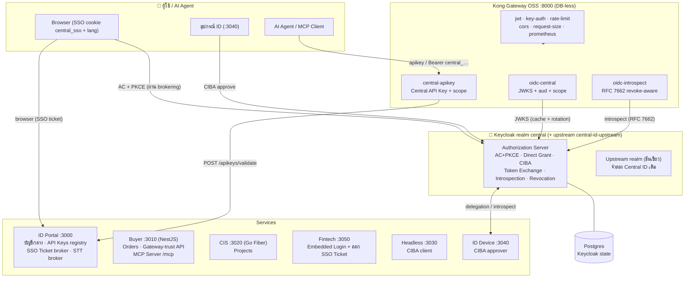
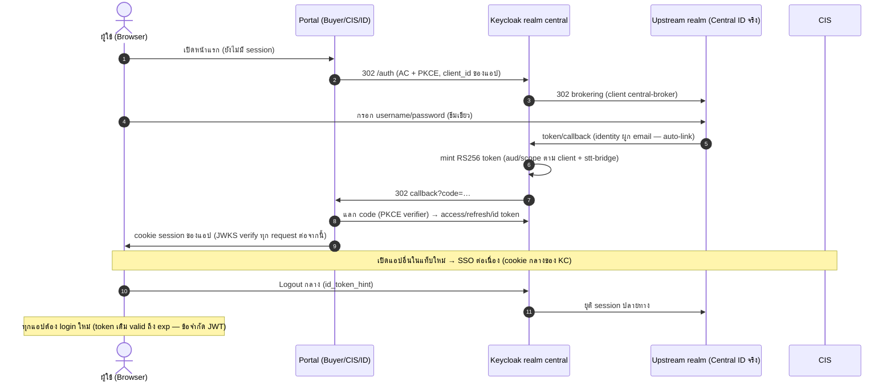
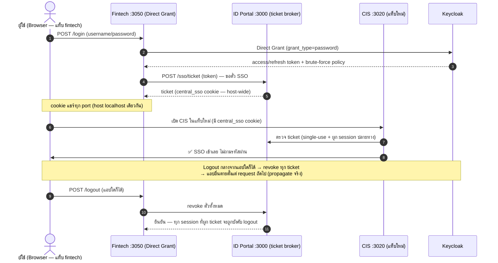
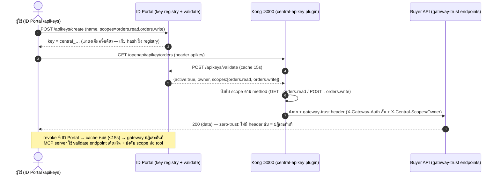
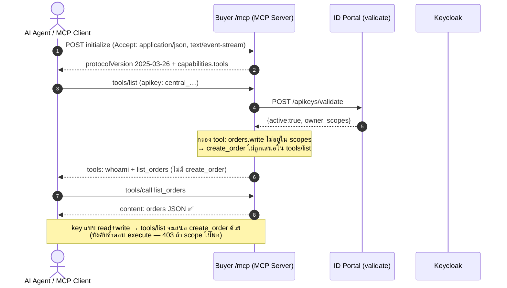
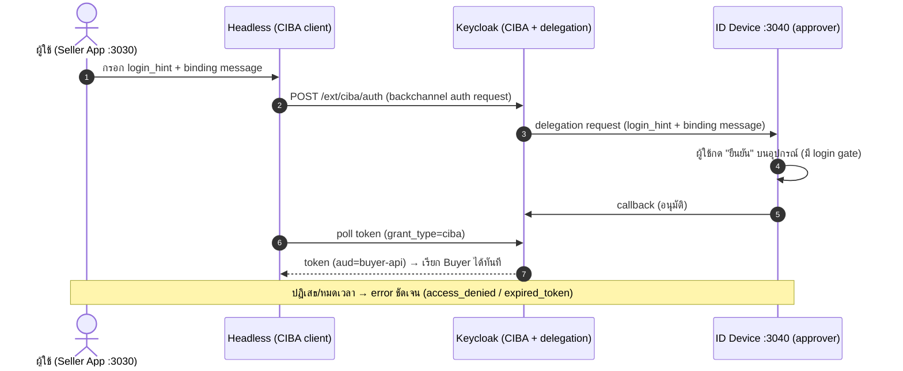
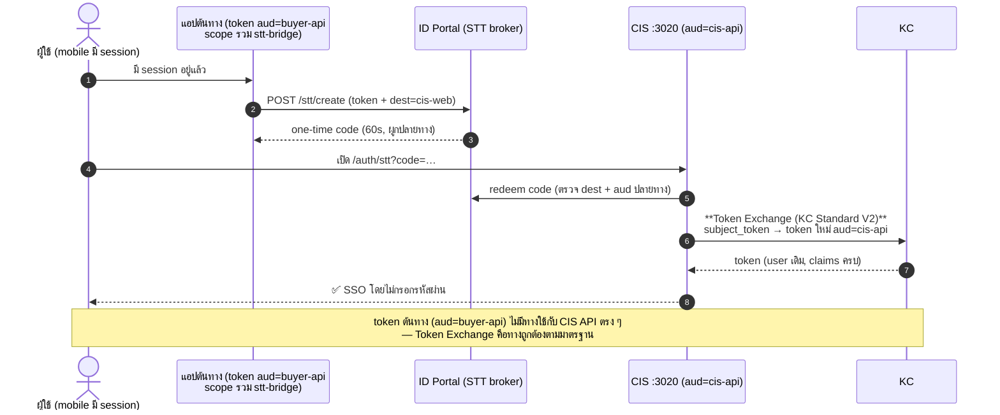
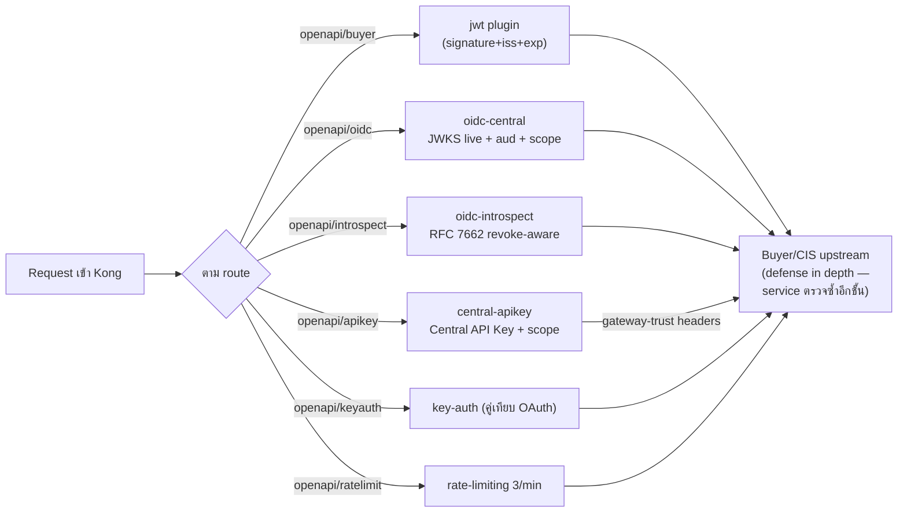

# Architecture — Central Identity POC (Keycloak + Kong Gateway)

ภาพรวมการทำงานทั้งระบบแบบ diagram (Mermaid — render ได้ใน GitHub) ครอบคลุมทุก flow ที่ POC นี้พิสูจน์ไว้
ทุก flow มี test script ครอบอยู่แล้ว (ดู [test-results.md](test-results.md) — 14 scripts / 198 checks PASS)

> อ่านคู่กับ: [README.md](../README.md) (EN, default) · [README-TH.md](../README-TH.md) (ไทย) · ADR-001..005

---

## 1. ภาพรวมระบบ (System Overview)

**ขอบเขตความเชื่อใจ (Trust boundaries):** เส้นแบ่งสีเทา = ไม่เชื่อถือ — ทุก service ตรวจ token/key ด้วยตัวเอง (JWKS หรือ validate endpoint) ไม่มี middleware กลางที่ต้อง "เชื่อ" โดยไม่ตรวจ

---

## 2. Flow ที่ 1 — Browser SSO (Authorization Code + PKCE + Identity Brokering)

ผู้ใช้ login ครั้งเดียวที่ upstream realm (ธีมเขียว — จำลอง Central ID เดิม) → realm `central` ออก token ให้ทุกแอป · session ตายเมื่อ logout กลาง

> ทดสอบ: `scripts/sso-test.sh` (10 checks) · screenshots 01–15

---

## 3. Flow ที่ 2 — Embedded Login + Central SSO Ticket (new-tab SSO)

แอปที่ต้องการฟอร์ม login ของตัวเอง (Fintech) ใช้ Direct Grant แล้ว **ออก SSO Ticket ให้ browser** — เปิดแอปอื่นในแท็บใหม่จะ SSO อัตโนมัติ และ **logout กลาง propagate จริง** (session ปลายทางผูกกับ ticket)

> ทดสอบ: `scripts/stt-test.sh` (33 checks) · screenshots 21–24 · brute force: ผิด 5 ครั้ง → ล็อกข้ามแอป 30s

---

## 4. Flow ที่ 3 — Central API Key (ID Portal ออก key ผูก scope → Kong → MCP)

ออก API key จาก ID Portal ผูก scope → ใช้ยิง Open API ผ่าน Kong (plugin ตรวจ key กับ ID Portal) — **MCP server ใช้ contract เดียวกัน**

> ทดสอบ: `scripts/openapi-test.sh` (31 checks — รวม 10 เช็ค apikey) · ใช้กับ MCP ได้ (ข้อ 5)

---

## 5. Flow ที่ 4 — MCP Server (AI agents)

`POST :3010/mcp` (Streamable HTTP, โหมด stateless JSON) — ทุก request ตรวจ key ก่อน แล้ว tools/list **กรอง tool ตาม scope ของ key** และ tools/call บังคับซ้ำตอน execute

> ทดสอบ: `scripts/mcp-test.sh` (12 checks) · เชื่อมจาก Claude Code/Cursor ดู README §11

---

## 6. Flow ที่ 5 — Headless CIBA (login โดยไม่กรอกรหัสผ่านบนอุปกรณ์ client)

> ทดสอบ: `scripts/ciba-test.sh` (16 checks) · screenshots 16–20

---

## 7. Flow ที่ 6 — STT Session Transfer (Token Exchange ข้าม audience)

> ทดสอบ: `scripts/stt-test.sh` (33 checks) · ADR-004

---

## 8. Kong Custom Plugins (Lua PDK)

| Plugin | ไฟล์ | หน้าที่ | จุดเด่น |
| ------ | ---- | ------ | ------ |
| `oidc-central` | `kong/custom/kong/plugins/oidc-central/` | JWKS (live fetch + cache) + ตรวจ aud + scope ที่ gateway | เติมสิ่งที่ jwt plugin OSS ข้าม |
| `oidc-introspect` | `kong/custom/kong/plugins/oidc-introspect/` | เรียก `/introspect` ตรวจ revocation | revoke → 401 ทันทีที่ gateway |
| `central-apikey` | `kong/custom/kong/plugins/central-apikey/` | ตรวจ Central API Key กับ ID Portal + scope ต่อ method | เพิ่ม/ยกเลิก key ไม่ต้องแตะ kong.yml |

---

## 9. แผนที่ Flow → Script → เอกสาร

| Flow | Script | Checks | ADR | หมายเหตุ |
| ---- | ------ | ------ | --- | -------- |
| Browser SSO + Brokering | `sso-test.sh` | 10 | ADR-001 | upstream realm ธีมเขียว |
| Embedded Login + Brute Force | `fintech-test.sh` | 5 | — | realm-wide lockout |
| SSO Ticket + Global Logout | `stt-test.sh` (ส่วน 7-8) | รวมใน 33 | ADR-004 | propagate จริง |
| STT + Token Exchange | `stt-test.sh` (ส่วน 1-6) | รวมใน 33 | ADR-004 | KC Standard V2 |
| Central API Keys | `openapi-test.sh` (ส่วน apikey) | รวมใน 31 | ADR-005 | dual header apikey/X-API-Key |
| MCP Server | `mcp-test.sh` | 12 | ADR-005 | scope-gated tools |
| Introspection gateway | `openapi-test.sh` (ส่วน introspect) | รวมใน 31 | ADR-005 | revoke-aware |
| Mobile PKCE | `mobile-test.sh` | 12 | — | RFC 8252 + rotation |

---

## 10. การตั้งค่าและข้อจำกัดสำคัญ

- **DNS บน Docker Desktop (Windows):** `KONG_DNS_ORDER: "A"` — ไม่งั้น Kong resolve ช้า 4–8s (SRV โดน SERVFAIL)
- **Kong 3.9 declarative flaky:** config ใหญ่ parse สุ่มล้ม `table index is nil` — `setup.sh` ฉีด explicit `id` ทุก entity เป็น workaround
- **cookie host-wide (`central_sso`, `lang`):** ใช้ได้เพราะทุกแอปอยู่ host `localhost` ต่าง port — production ใช้ subdomain เดียวกัน (เช่น `*.central.example`)
- **JWT limitation:** revoke/disable แล้ว access token เดิม valid ถึง exp — ปลายทางที่ตรวจด้วย introspection (route introspect) ปิดจุดนี้ได้
- **production hardening ที่ยังไม่อยู่ใน POC:** backchannel logout, HA, WAF, mTLS, per-key quota

รายละเอียดทั้งหมด (รวมสิ่งที่เจอจริงระหว่างทำ): [test-results.md](test-results.md) findings 1–55 · ADR-001..005
